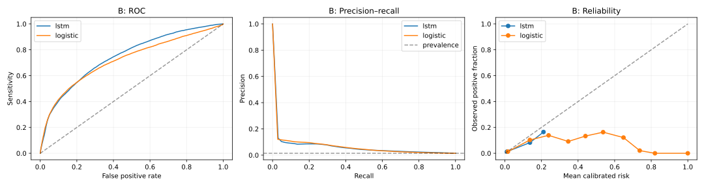

# SepsisGuard-UAR evaluation results — 2026-11-08

The frozen LSTM showed moderate retrospective discrimination on the public B holdout, with low precision at useful recall levels. Its average precision was essentially tied with the frozen logistic baseline. The Qwen agent failed the predeclared explicit patient-value grounding criterion in this 12-case development sample, despite passing its citation and same-model verifier checks. Independent clinician-rated explanation quality remains unmeasured.

## Execution and protocol

Executed directly in connected Colab Pro on A100-SXM4-80GB (79.25 GiB VRAM), 167.05 GiB system RAM, Torch 2.14.1+cu130, Python 3.13.16. Source commit: `974357f175579725d3db78952c74ffb625cc4bd8`. Evaluation source fingerprint: `799969bb1f05b5bdd2b3be1f0c9b11ae74ac8c80d9dc7f617e39ca7380b5457e`.

Run: `evaluation-50700700b0af7403f6fc`. Frozen protocol SHA256: `50700700b0af7403f6fc66f19d27ea93b82d3e969696c26fb484d4bf65bd7133`. The protocol was written and read-verified in private Drive before B prediction access. It fixes both existing predictors, A/train preprocessing, A/calibration-only sigmoid calibration, A/validation-only thresholds, metrics, bootstrap rules, explanation sampling, prompts and corpus. No predictor retraining or B-driven threshold tuning occurred. Scoring uses FP32 frozen-model logits; original training/selection used BF16, so reevaluated validation scores need not exactly equal the historical training log.

B contains 20,000 patient records, 761,995 hours, 1,142 records with positive labels and 10,780 positive hours (1.4147%). It is public retrospective development data, not the hidden Challenge leaderboard test set. Prior descriptive B auditing did not guide this protocol. B is now consumed for this fixed comparison and cannot be reused as a fresh holdout for later model selection.

## Clinical performance

Calibrated hourly results; 95% percentile confidence intervals use 500 whole-patient file resamples with seed 42. All reported intervals had 500 valid draws. They condition on the frozen models, calibrators and thresholds, and assume the published record IDs represent distinct people.

| Model | AUROC (95% CI) | Average precision (95% CI) | Brier | Log loss | ECE, 10 bins |
|---|---:|---:|---:|---:|---:|
| LSTM | 0.74696 (0.73178–0.76052) | 0.05401 (0.04898–0.06030) | 0.013734 | 0.068641 | 0.002562 |
| Logistic | 0.72096 (0.70570–0.73561) | 0.05431 (0.04810–0.06245) | 0.013915 | 0.070054 | 0.004396 |

The paired LSTM-minus-logistic AP difference was −0.000305, with 95% patient-bootstrap interval [−0.006849, 0.005038]. This comparison does not establish an AP advantage for the selected LSTM. Selection remains the original A/validation decision.

Applying A/calibration-fitted calibration reduced LSTM Brier from 0.092643 to 0.013734 and log loss from 0.309006 to 0.068641 on B; AUROC/AP were unchanged. These global calibration measures do not establish subgroup reliability or clinical benefit.

| Model / A-validation rule | Frozen calibrated cutoff | Hourly sensitivity | Hourly PPV | Nonseptic records with any alarm | Alarm episodes /100 nonseptic hours | Normalized timing utility |
|---|---:|---:|---:|---:|---:|---:|
| LSTM / 80% validation recall | 0.013587 | 64.42% | 3.17% | 99.88% | 6.275 | 0.06351 |
| LSTM / maximum validation utility | 0.037643 | 33.52% | 6.77% | 11.79% | 0.931 | 0.21104 |
| Logistic / 80% validation recall | 0.017145 | 65.99% | 2.86% | 63.90% | 7.089 | 0.01121 |
| Logistic / maximum validation utility | 0.025061 | 47.17% | 4.72% | 33.02% | 3.015 | 0.20254 |

At the LSTM recall rule, sensitivity CI was 61.81–66.86% and PPV CI 2.98–3.36%. Its utility-rule normalized timing utility CI was 0.18735–0.23552; logistic utility CI was 0.17553–0.23105. No paired utility superiority claim is made. The fixed calibrated 0.5 cutoff produced no LSTM alarms on B; logistic hourly sensitivity was only 0.24% at that cutoff.

The recall-oriented LSTM rule alerted on nearly all nonseptic records and did not retain 80% recall on B. The utility-oriented rule reduced alarm burden while missing most positive hours. These are measured research operating points, not recommended clinical cutoffs. Episode counting uses a predeclared six-hour refractory interval; it is not necessarily the alarm implementation a clinical service would choose.

Official PhysioNet timing utility was checked against the pinned upstream scorer. Labels are already shifted six hours and were not shifted again. The JSON also retains patient-ever-alarm and label-relative detection summaries. Patient-ever sensitivity allows an alarm at any time; reported lead times use the shifted-label clock and must not be described as measured clinical-onset lead times.

## Patient-specific explanation audit

The 12 unique A/validation patients were selected without outcome labels, before B scoring: one hashed-time endpoint per validation patient, then four calibrated-risk quartiles with low/median/high window missingness. This stratified development sample is not a representative population estimate.

Real local Qwen3.8-27B BF16 inference used pinned revision `1d4bf0f2ff6012fd82039f2fa52739d0dd7c60c0`, Transformers 5.22.1 and the unchanged 19-passage CDC/NIH corpus. Run: `agents-0096b8a80c413c2311c2`. It made 36 calls (12 planner, 12 writer, 12 verifier), 12 retrievals, and generated 1,972 tokens in 261.96 seconds of model-call time, excluding loading and other processing. Peak allocated memory during model loading was 50.964 GiB; generation peak memory was not measured. Reference PyTorch kernels were used.

| Automated measure | Observed result |
|---|---:|
| Cases returning supported research context | 12/12 |
| Abstentions | 0/12 |
| Claims passing repeated citation/numeric checks | 24/24 |
| Cases with current observed measurements available | 8/12 |
| Outputs explicitly pairing a feature with its observed value and patient-context language | 0/12; also 0/8 eligible cases |
| Exact duplicate output fraction after normalization | 75% |
| Unique retrieval queries | 3 across 12 searches |
| Mean pairwise output TF-IDF cosine similarity | 0.8336 |
| Grounded coverage of top-five input-ablation features | 0% |
| Mean fraction of top-five ablation features visible in the generator's current observations | 21.67% |
| Completed independent clinician ratings | 0 |

A feature/value grounding proxy can miss qualitative patient-specific language. It is not a clinical relevance grade or independent semantic truth test. The findings nevertheless show that the current agent did not demonstrate the predeclared explicit patient-value grounding behavior. Citation validity and same-backbone verification do not establish patient-specific usefulness, claim entailment or clinical correctness. Ablation measures predictor sensitivity to removed value/mask channels, not causal physiological effects. The agent does not change the predictor's scores; this run cannot show improved clinical prediction from agent reasoning.

The two earlier three-case runs were also re-audited and retained. The first abstained three times; the later full-graph run had zero explicit grounding among three outputs. They are historical checks, not additional independent population samples.

## Independent review, verification and next work

A private, randomized 12-case review packet contains causal observations, explanations and cited text, with original IDs, outcomes and model identity hidden. A separate private mapping is retained. All 12 clinician rating rows are blank. Clinical relevance, specificity, observation accuracy, evidence support, misleading content and inter-rater agreement require real independent annotations. No reviewer was contacted and no ratings were generated by an LLM.

Live Colab readback verified 12 evaluation artifacts and all 12 case checksums, 12 distinct validation patients, the blank review rows and both unchanged frozen weight hashes. Four aggregate export files were transferred byte-for-byte and checked against live Colab SHA256 hashes. Raw records, predictions, manifests, fitted calibration coefficients, input ablations and review material remain private in Drive under `SepsisGuard-UAR/evaluations/evaluation-50700700b0af7403f6fc` (case traces under `agents/agents-0096b8a80c413c2311c2`).

All 64 tests passed locally (53.00 s) and on GitHub CI (81.92 s, run 42533201997, job 128891737591) for the executed source. Checks include utility parity, patient-bootstrap parity, frozen B gating, outcome-blind sampling, causal input/privacy checks and synthetic end-to-end evaluation. A notebook-kernel import path issue affected only the extra inspection cell and was corrected; the real evaluation subprocess completed successfully.

Future explanation work can improve use of causal patient context and compare budget-matched agent variants on development data, followed by blinded independent annotation. Predictor changes require a new independent evaluation cohort; this B result must not guide retuning while still being called untouched test performance. Prospective clinical effectiveness, subgroup validity and agent utility remain unestablished.

Aggregate evidence: [execution JSON](evaluation-50700700b0af7403f6fc/EVALUATION_RESULT.json), [runner report](evaluation-50700700b0af7403f6fc/EVALUATION_REPORT.md), [live readback](evaluation-50700700b0af7403f6fc/EVALUATION_READBACK.json), [export hashes](evaluation-50700700b0af7403f6fc/EXPORT_HASHES.json). Methods: [frozen protocol](../../docs/EVALUATION_PROTOCOL.md).
